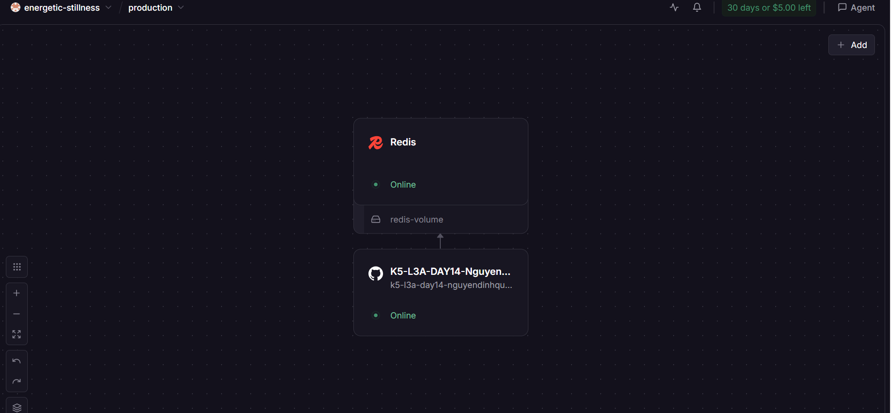
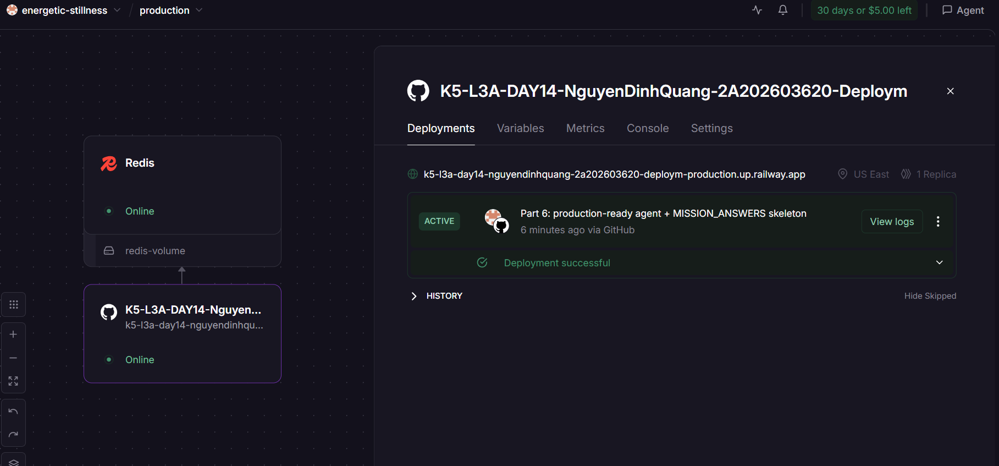
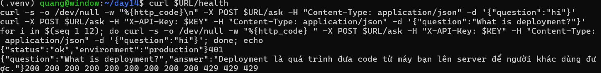

# Deployment — Day 14 Production Agent

## Public URL
**https://k5-l3a-day14-nguyendinhquang-2a202603620-deploym-production.up.railway.app**

- **Platform:** Railway (build từ `06-lab-complete/Dockerfile`, cấu hình `06-lab-complete/railway.toml`)
- **Root Directory:** `06-lab-complete`
- **Services:** agent (FastAPI + uvicorn) + Redis (Railway database, có volume `redis-volume`)

## Environment variables
| Variable | Giá trị |
|---|---|
| `PORT` | Railway tự cấp (8080) |
| `REDIS_URL` | `${{Redis.REDIS_URL}}` (tham chiếu tới service Redis) |
| `AGENT_API_KEY` | secret, đặt trong Railway Variables (không commit) |
| `LOG_LEVEL` | `INFO` |
| `RATE_LIMIT_PER_MINUTE` | `10` |
| `MONTHLY_BUDGET_USD` | `10` |
| `ENVIRONMENT` | `production` |

## Test commands
```bash
URL=https://k5-l3a-day14-nguyendinhquang-2a202603620-deploym-production.up.railway.app
KEY=<AGENT_API_KEY>
```

### Health check (liveness)
```bash
curl $URL/health
```
Expected:
```json
{"status":"ok","environment":"production"}
```

### Readiness (Redis connected)
```bash
curl $URL/ready
```
Expected:
```json
{"status":"ready","redis":"ok"}
```

### Không có API key → 401
```bash
curl -s -o /dev/null -w "%{http_code}\n" -X POST $URL/ask \
  -H "Content-Type: application/json" -d '{"question":"hi"}'
```
Expected: `401`

### Có API key → 200
```bash
curl -X POST $URL/ask -H "X-API-Key: $KEY" \
  -H "Content-Type: application/json" -d '{"question":"What is deployment?"}'
```
Expected:
```json
{"question":"What is deployment?","answer":"Deployment là quá trình đưa code từ máy bạn lên server để người khác dùng được."}
```

### Rate limit (10 req/phút) → 429
```bash
for i in $(seq 1 12); do curl -s -o /dev/null -w "%{http_code} " -X POST $URL/ask \
  -H "X-API-Key: $KEY" -H "Content-Type: application/json" -d '{"question":"hi"}'; done; echo
```
Kết quả thực tế (sau 1 request trước đó):
```
200 200 200 200 200 200 200 200 200 429 429 429
```

## Production readiness check
```bash
cd 06-lab-complete
python check_production_ready.py --public-url $URL
```

## Screenshots
- Railway dashboard (agent + Redis online): 
- Service đang chạy / logs: 
- Kết quả test: 
